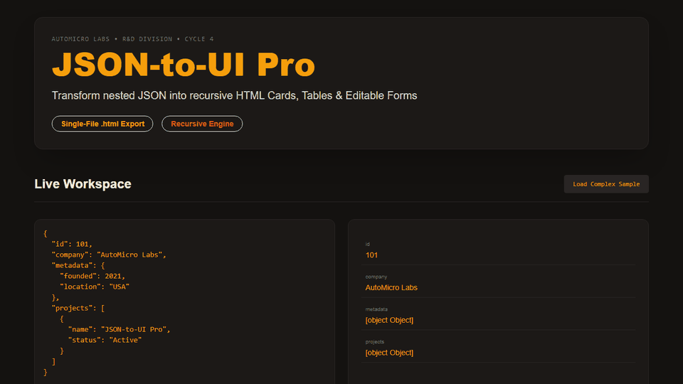
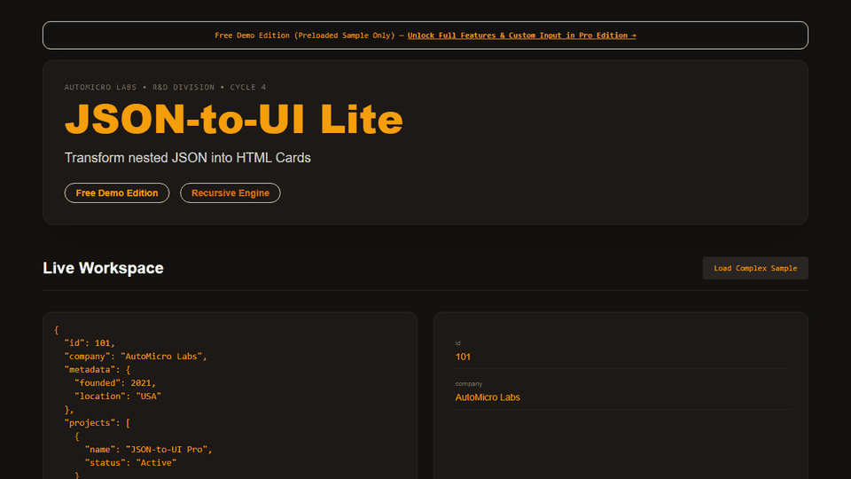

# JSON-to-UI Mockup Generator

> 100% Local Browser Tool • Single-File Export • Zero Subscriptions

JSON-to-UI Mockup Generator transforms structured raw JSON into interactive UI mockups instantly. Built for developers, technical product managers, and UI designers who need immediate visual feedback without writing frontend layout boilerplate.

---

## Full Pro Edition Preview

Get the complete tool with full view options and standalone HTML exports:
👉 **[Get the Full Offline Pro Edition](https://bobservice.gumroad.com/l/json-schema-wizard?utm_source=github)**

---

## Free Live Demo Preview

Test the instant card view rendering directly in your browser:
👉 **[Try the Free Live Demo](https://nexusmedialab04-art.github.io/json-to-ui-mockup-generator/)**

---

## Free Demo vs Full Pro Edition

| Feature | Free Demo (Lite) | Full Pro Edition |
| :--- | :---: | :---: |
| **Workspace Section** | JSON-to-UI Lite | JSON-to-UI Pro |
| **Client-Side Processing** | Yes | Yes |
| **Load Complex Sample Button** | Yes | Yes |
| **Generate UI Button** | Yes | Yes |
| **Card View Mode** | Yes | Yes |
| **Table View Mode** | No | Yes |
| **Form View Mode** | No | Yes |
| **Download .html Export** | No | Yes |

---

## How to Use

1. **Paste JSON or Load Sample**: Click `Load Complex Sample` to test standard structured data.
2. **Select Layout Mode**: Choose `Card View` (or switch to `Table View` / `Form View` in Pro).
3. **Generate UI**: Click `Generate UI` to render components inside the Live Workspace.
4. **Export (Pro)**: Click `Download .html` to save a self-contained output file for distribution or presentation.

---

## License & Legal

Please see `LEGAL_DISCLAIMER` for license information and terms of usage.